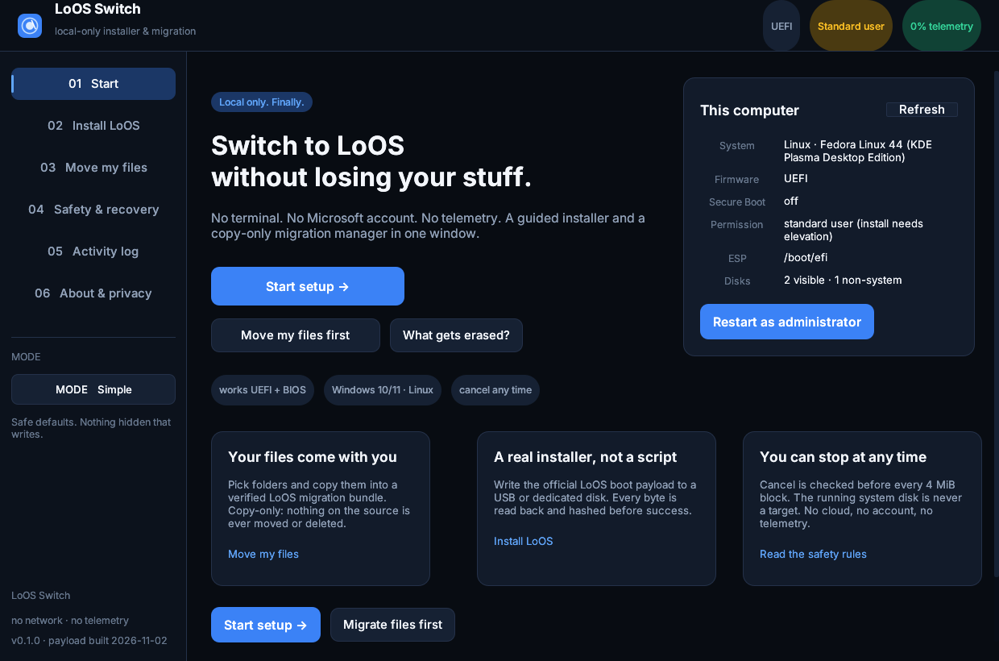

# LoOS Switch

**A local-only installer and migration manager for [LoOS](../README.md).**

LoOS Switch is a Rust + egui desktop app for **Windows 10/11** and **Linux**.
It does the part that is normally hidden from non-technical users — choose a
safe disk, write a verified LoOS installer, add the boot entry, and copy the
files that matter — while refusing the unsafe shortcuts.

- **0% telemetry.** No HTTP/TLS client, no analytics, no account, no update
  pings, no device IDs. Disconnect the network; every feature still works.
- **Cancelable at every practical boundary.** Cancel is checked before every
  4 MiB block, every file and every verification chunk.
- **Copy-only migration.** Sources are opened read-only, hashed, journaled, and
  verified. Nothing is moved or deleted.
- **No silent whole-disk writes.** The running system disk is refused as a
  target. A destructive media write requires an explicit typed confirmation.
- **Beginner and power-user paths.** One obvious action by default; exact
  firmware, disk, boot label, unattended and direct-home options when wanted.



## What it actually does

There are two honest ways to put LoOS on a machine, because an OS cannot safely
repartition the disk it is running from while its filesystems are mounted.

| Path | What happens | Best for |
|---|---|---|
| **Install media** | Writes a complete, hash-verified LoOS installer image to a USB drive or dedicated disk. Reboot into it and LoOS Setup installs the OS. Supports **UEFI and legacy BIOS**. | Replacing the current disk; the universal route. |
| **Local UEFI staging** | Copies a small setup loader to the **existing ESP**, adds a firmware boot entry, and reboots into LoOS Setup. **No repartitioning or erasing.** | A second internal disk, dual-boot, no USB stick. |
| **Move my files** | Builds a portable `LoOS-Migration` bundle with `home/<user>/...`, a SHA-256 manifest, a journal and `RESTORE.txt`. Can also copy directly into a mounted LoOS home. | Before or after installing. |

The app never fabricates a "replace Windows in place" button. It explains why
that operation needs boot media — the same reason every mainstream Linux
installer asks you to reboot.

### Unattended target install (power users)

Local UEFI staging can start LoOS Setup with an exact target size and a
one-time account. The kernel refuses the boot media disk and refuses an
ambiguous size match. Use a temporary password and change it after first login;
the credential is written to the ESP only until Setup consumes it, and the
installed system's command line is scrubbed of all `installer.*` arguments by
the LoOS installer.

## Build

Prerequisites on Linux:

- Rust 1.88+ (the workspace pins 1.97.1)
- `clang`, `lld`, `sgdisk`, `mtools`, `python3`, `zstd` for rebuilding the LoOS payload
- `x86_64-w64-mingw32-gcc` and the Rust `x86_64-pc-windows-gnu` target for the Windows build
- `curl` for the one-time AppImage packaging tool

```bash
cd migrationapp
./scripts/rebuild-payload.sh     # only when the LoOS boot/installer tree changed
./scripts/build-linux.sh
./scripts/package-linux.sh       # dist/LoOS-Switch-0.1.0-x86_64.AppImage
./scripts/package-windows.sh     # dist/LoOS-Switch-0.1.0-windows-x64.exe
./scripts/test.sh
```

The nested app deliberately builds from `$HOME` with a workspace-local
`CARGO_HOME`; the parent LoOS workspace replaces crates.io with a vendor
directory that does not contain GUI crates.

### Headless / power-user commands

```bash
loos-switch --self-test
loos-switch --list-disks
loos-switch --extract-payload uefi /tmp/loos-uefi.img

# Destroys the selected whole disk. Requires root/Administrator and --yes.
loos-switch --make-media --device /dev/sdX --firmware uefi --yes

# Adds only ESP files + a boot entry. No repartitioning.
loos-switch --stage-uefi

# Fully automated second-disk install after reboot (temporary password).
loos-switch --stage-uefi --unattended --target-disk 1 \
  --user switch --password 'temporary-pass' --hostname loos-pc --yes

# Copy-only migration; source is never modified.
loos-switch --backup ~/Documents ~/Pictures --to /media/backup --user alice
loos-switch --backup ~/Documents --to /mnt/loos/home/alice --direct-home
```

`--screenshot` is a QA helper used to render each page headlessly.

## Safety model

1. **System disk refusal.** The disk hosting `/`, `/boot` or the running Windows
   installation is classified as `system` and cannot be opened as a raw target.
2. **Mounted target refusal.** Install media requires an unmounted target.
   Windows volume handles are locked/dismounted only after the explicit plan is
   confirmed.
3. **Typed confirmation.** Media writes require `ERASE`; local staging requires
   `STAGE`; unattended staging requires both `ERASE` and `--yes`.
4. **Payload integrity.** The zstd-compressed image and the decompressed raw
   image both have SHA-256 digests compiled into the binary. A mismatch aborts.
5. **Readback verification.** After writing, the same bytes are read back from
   the target and hashed before success is reported.
6. **No hidden writes.** The app writes only a target you selected, the ESP for
   local staging, or a migration destination you selected.
7. **No telemetry.** There is no network code path. See
   [docs/PRIVACY.md](docs/PRIVACY.md).

## Known limits (read before using)

- This LoOS build is **unsigned**. Secure Boot must be off (or a signed build
  supplied) for LoOS to boot.
- Local UEFI staging needs a writable ESP and firmware that accepts a new
  `Boot####` entry. If the firmware refuses, use install media.
- Replacing the **currently running** disk requires install media. This is a
  design constraint, not a bug.
- Windows direct staging uses UEFI NVRAM. Some firmware ignores entries that
  do not go through its own update tool; use the boot menu or install media as
  a fallback.
- Migration `--direct-home` expects an already mounted LoOS `/home/<user>` (for
  example from a Linux live environment). The default bundle can be copied
  later and is the safer choice.
- The embedded payload is built from the current LoOS tree. Re-run
  `scripts/rebuild-payload.sh` after changing the installer.
- Windows binaries are not code-signed; SmartScreen may warn. Builds are
  reproducible from source and include SHA-256 files.

## Layout

```
src/main.rs        CLI + eframe entry point
src/app.rs         screens, state machine, worker/cancel handling
src/install.rs     deployment engine (media + local staging)
src/migration.rs   cancelable, hashed copy engine
src/payload.rs     embedded payload, SHA-256, GPT/FAT32 extractor
src/platform/      Linux and Windows disk/elevation/boot-entry backends
src/theme.rs       visual language
assets/            payload, fonts, icon, manifest
scripts/           build, package, payload reproduction
docs/              architecture, safety, privacy, build notes
```

Licensed MIT. Third-party notices: [THIRD-PARTY.md](THIRD-PARTY.md).
